### Hi, I'm Joe 👋

I'm a backend and systems developer and I run **248Tech LLC**. I build software you host yourself, so you keep your data and don't pay a subscription:

- 🛠️ **Infrastructure that fixes itself:** agents that watch servers, catch problems early and recover without someone on call.
- 🎮 **Game-server tooling:** control planes, Discord bots and automation for 7 Days to Die and Minecraft communities.
- 📦 **Practical business software:** rental inventory, site measurement and event layout tools that grew out of real day-to-day work.
- 🪟 **Small Windows apps** that do one job well, with no ads and no telemetry.

Most projects have a **live demo** you can try in the browser. See them all at **[248tech.github.io](https://248tech.github.io)**.

<b>Need something built?</b> <a href="https://248tech.github.io/project-inquiry/">Start a project →</a> · ✉️ <a href="mailto:joe@248tech.com">joe@248tech.com</a>

---

#### 🛰️ Self-hosted platforms

| Project | What it does | Stack |
|---|---|---|
| [**RTSPanda**](https://github.com/248Tech/RTSPanda) · [demo](https://248tech.github.io/RTSPanda/) | RTSP camera platform: live view in the browser, recording, YOLO/Frigate detection alerts, Prometheus metrics | Go · React |
| [**ShowTime**](https://github.com/248Tech/ShowTime) · [demo](https://248tech.github.io/ShowTime/) | Watch-party server with synced rooms, an encrypted library, AV1/VP9 encoding and E2E-encrypted chat | Node.js · WebRTC |
| [**litemap**](https://github.com/248Tech/litemap) · [demo](https://248tech.github.io/litemap/) | Measure sites from satellite imagery: areas, distances, to-scale tents and vehicles, OpenAPI REST API | Node.js · ONNX |
| [**GarageIQ**](https://github.com/248Tech/GarageIQ) · [demo](https://248tech.github.io/GarageIQ/) | Restoration manager for vehicle builds: dependency-aware checklists, parts and expenses, offline PWA | Node.js · SQLite |
| [**RentalOS**](https://248tech.github.io/rentalos-site/) | Event rental software: inventory, quotes, conflict detection, pull sheets, e-signatures *(source private)* | React · Rust · SQLite |

#### 🎮 Game-server operations

| Project | What it does | Stack |
|---|---|---|
| [**Mastermind 7DTD**](https://github.com/248Tech/Mastermind-7DTD-AI-Server-Manager) | Multi-server 7 Days to Die control plane and host agent: safe restarts, live map, player portal, Discord | TypeScript · Go |
| [**Mastermind Minecraft**](https://github.com/248Tech/Mastermind-Minecraft-Server-Manager) | The same control plane for Minecraft: RCON console, mods and plugins, saves, health checks | TypeScript |
| [**RegionHealer v2**](https://github.com/248Tech/RegionHealer-v2) | Finds corrupt 7DTD region files, restores them from backup and restarts the server safely | Shell |
| [**fortnite-updates-bot**](https://github.com/248Tech/fortnite-updates-bot) · [demo](https://248tech.github.io/fortnite-updates-bot/) | Discord bot that posts Battle Royale, Save the World and Creative news | Python |

#### 🪟 Windows apps

| Project | What it does | Stack |
|---|---|---|
| [**Tidy**](https://github.com/248Tech/Tidy) · [site](https://248tech.github.io/Tidy/) | Friendly PC cleaner and system monitor: apps eating RAM/CPU, a storage treemap, quick clean with Recycle Bin undo, remote access from your phone | Go · Svelte |
| [**Tidy Lite**](https://github.com/248Tech/Tidy-Lite) · [site](https://248tech.github.io/Tidy-Lite/) | The 111 KB native edition of Tidy: no web engine, no installer, built for old and low-memory PCs | C# |
| [**QwenPad**](https://github.com/248Tech/QwenPad) · [demo](https://248tech.github.io/QwenPad/) | Sticky notes and a small Notepad with a fully offline local AI (Qwen + llama.cpp) | C# |
| [**ImgConvert**](https://github.com/248Tech/ImgConvert) · [demo](https://248tech.github.io/ImgConvert/) | Offline batch image converter: HEIC to JPG, PNG, WebP and more. Portable, no telemetry | Python |
| [**LyricVision**](https://github.com/248Tech/LyricVision) · [demo](https://248tech.github.io/LyricVision/) | Synced Spotify lyrics drawn over your games as a click-through overlay | C# |
| [**GhostReel**](https://github.com/248Tech/GhostReel) | Always-on-top, click-through video overlay built on a stripped-down libVLC | C |
| [**DarkNotepad**](https://github.com/248Tech/DarkNotepad) · [demo](https://248tech.github.io/DarkNotepad/) | A dark-mode Notepad replacement | PowerShell |

---

**Tools I use:** Go · TypeScript · Python · C# · C · Node.js · React · NestJS · Docker · SQLite · Postgres · Linux/systemd · Discord bots

🌐 **[248tech.com](https://248tech.com)** `[WIP]`: the company site is still being built. Until it's ready, [start a project](https://248tech.github.io/project-inquiry/) or email [joe@248tech.com](mailto:joe@248tech.com). For bugs, open an issue on the repo.
